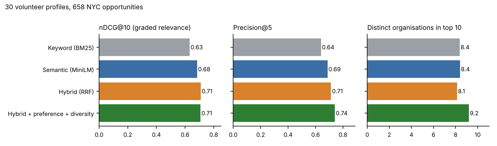

# Volunteer matcher

**Type what you'd like to do as a volunteer, in your own words, and get ranked opportunities, each with a one-line reason.**

This is a small, evaluated prototype of AI-assisted volunteer matching. It searches 658 real volunteering listings from New York City and combines two kinds of search:

- **Keyword search (BM25).** This finds exact terms such as "CPR" or "Drupal".
- **Semantic search.** This uses all-MiniLM-L6-v2 sentence embeddings run through ONNX. It finds matches that share no words with the request. For example, for "I'd like to look after pets", semantic search ranks "Animal Foster Parent" 4th. Keyword search scores it zero, because the listing says "animals", not "pets".

Every method is tested on 30 volunteer profiles against graded relevance labels. The project reports where each design choice helps and where it hurts.



## How it works

```
volunteer text ──► BM25 ranking ─┐
              └─► MiniLM ranking ─┴─► reciprocal rank fusion ──► constraint / preference ──► diversity (MMR + max 3 per organisation) ──► top-k + reason
```

1. **Hybrid retrieval.** The two rankings are merged with reciprocal rank fusion. RRF needs no score calibration and no tuning data.
2. **Commitment preference.** The volunteer's commitment is detected from the text (for example "one-off" or "every week"). If it is a firm constraint, such as "I can **only** do one day", listings of the other type are filtered out. If it is only a preference, they are moved down the ranking but still shown.
3. **Diversity.** Maximal marginal relevance limits near-duplicate results, and each organisation is capped at 3 results. Without this cap, a single organisation that posts many listings can fill the whole page.
4. **Explanation.** Each result comes with the sentence from the listing that is closest to the request, so the volunteer can see why it was suggested.

## Results (30 profiles, 603 graded judgments)

| Method | P@5 | nDCG@10 | MRR | Distinct orgs in top 10 |
|---|---|---|---|---|
| Keyword (BM25) | 0.64 | 0.63 | 0.89 | 8.4 |
| Semantic (MiniLM) | 0.69 | 0.68 | 0.89 | 8.4 |
| Hybrid (RRF) | 0.71 | **0.71** | 0.91 | 8.1 |
| Hybrid + preference + diversity | **0.74** | 0.71 | **0.94** | **9.2** |

The 95% confidence intervals below come from a paired bootstrap over profiles.

- **Hybrid beats keyword search.** nDCG@10 rises by 0.077 (CI 0.009 to 0.145), which is about 12%. Hybrid ranks better on 21 of the 30 profiles.
- **Hybrid versus semantic only:** +0.025, which is not significant (CI −0.056 to 0.109). Most of the gain over keywords comes from the embeddings. Fusion makes results more reliable, because neither method alone fails on all the profiles where the other fails.
- **Diversity has a measured cost.** Adding the diversity step and the organisation cap lowers nDCG on 21 of 30 profiles, by a small amount each time. In exchange, the top 10 shows about one more distinct organisation on average. The clearest loss is the recycling profile: one city office posts most of the recycling listings, and the cap pushes some of them down. Whether that trade is worth making is a product decision, so `max_per_org` and `mmr_lambda` are parameters you can set.
- **Constraint handling:** for "I can only do one day", the share of one-off results in the top 10 goes from 0–20% to 100%. I added the hard filter *after* seeing this profile fail, so read this as a fixed failure case, not an unbiased measured gain.

## Evaluation method and its limits

- **Profiles.** I wrote 30 volunteer profiles covering skills, interests and commitment, for example "Retired primary school teacher… help children learn to read, ideally every week" (see `data/profiles.json`).
- **Labels.** For each profile, I pooled the top 10 results from all four methods and graded each listing: 2 = a clear match, 1 = related, 0 = not useful. The labels were drafted with LLM assistance against this rubric and are one annotator's judgments, so treat differences of a few points as noise. They are in `data/qrels.json` so anyone can check or change them.
- **Silver check.** I also measured how often the top 5 results fall in the category the profile implies, using the dataset's own category field. This check is coarse, because 46% of listings fall under "Strengthening Communities", and it barely separates the methods (0.57 to 0.59).
- **Data.** The data is 2011 NYC Service listings (NYC Open Data), using a public copy from a DataCamp course repository. Some fields are unreliable. For example, one listing is marked one-off but describes a 30-hours-a-week internship.
- **Not covered.** There is no location or distance filter, no learning from the listings people accept, and no user testing. With real platform data, the natural next step is to learn from accepted and declined suggestions and to add travel time.

## Run it

```bash
pip install -r requirements.txt
python scripts/get_model.py          # downloads all-MiniLM-L6-v2 ONNX (~90 MB, pinned revision)
python -m pytest -q tests            # 8 tests
python evaluate.py                   # writes results/
uvicorn vmatch.api:app --port 8000   # POST /match {"text": "...", "k": 5}
```

Or with Docker: `docker build -t vmatch . && docker run -p 8000:8000 vmatch`. GitHub Actions runs the tests and the evaluation, then builds the image and checks it responds.

Privacy: the API uses the volunteer's text only to rank results. It does not store or log it.

---
Kian Shafiei · MSc Applied AI for Engineering (Distinction) · [LinkedIn](https://www.linkedin.com/in/kianshafiei/)
